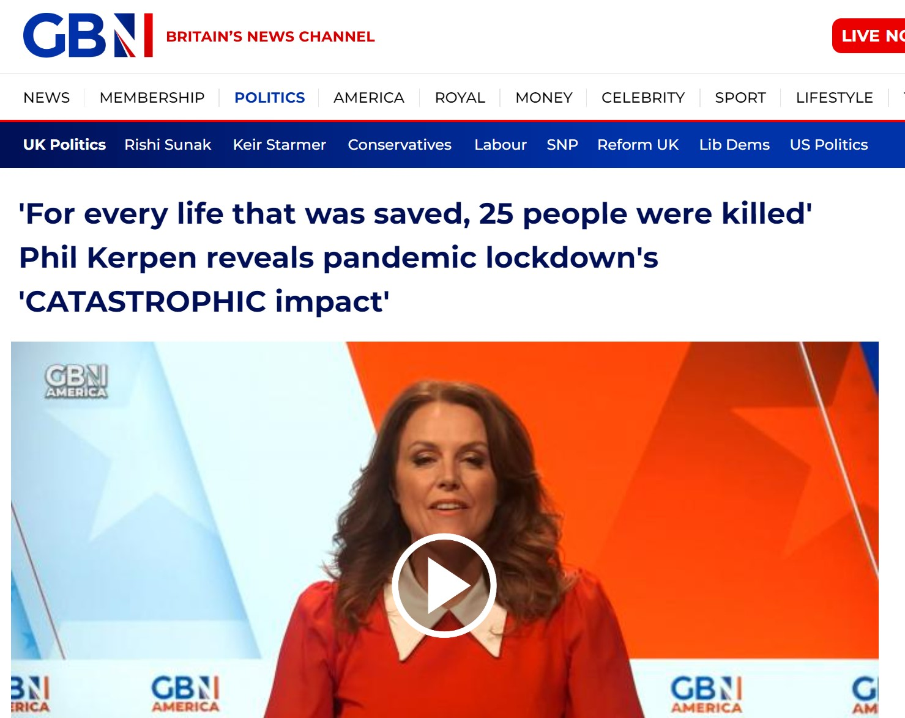

```{r global_options, echo = FALSE, include = FALSE}
options(width = 999)
knitr::opts_chunk$set(echo = FALSE, warning = FALSE, message = FALSE,
                      cache = FALSE, tidy = FALSE, size = "small")
```
```{r echo=F,message=FALSE,warning=FALSE,comment=NA}
# Sources the R file with all the relevant setup and commands
source("assets/setup.R")

# Stuff from 'xaringanExtra' (https://pkg.garrickadenbuie.com/xaringanExtra)
# This allows the use of panels (from 'xaringanExtra')
xaringanExtra::use_panelset()
# This allows to copy code from the slides directly
#xaringanExtra::use_clipboard()
# This freezes the frame for when there's a gif included
#xaringanExtra::use_freezeframe()

# Defines the path to the file with the .bib entries (in case there are references)
#bibfile=RefManageR::ReadBib("C:/users/magb/Dropbox/Conferences-Talks/GEOMED/GEOMED2024/refs.bib",check = FALSE)
```
class: title-slide

# `r rmarkdown::metadata$title``r vspace("10px")` `r rmarkdown::metadata$subtitle`

## `r rmarkdown::metadata$author`

### `r rmarkdown::metadata$institute`    

### `r rmarkdown::metadata$params$conference`, `r rmarkdown::metadata$params$location` 

<!-- Can also separate the various components of the extra argument 'params', eg as in 
### `r paste(rmarkdown::metadata$params, collapse=", ")`
-->

`r ifelse(is.null(rmarkdown::metadata$params$date),format(Sys.Date(),"%e %B %Y"),rmarkdown::metadata$params$date)`

`r vspace("20px")`

`r include_fig("MRC-Centre-Logo.png", width="30%")`

---

layout: true  

.my-footer[ 
.alignleft[ 
&nbsp; &copy; Marta Blangiardo 
]
.aligncenter[
`r rmarkdown::metadata$params$short_title` 
]
.alignright[
`r rmarkdown::metadata$params$conference`, `r short_date` 
]
] 

```{css,echo=FALSE, eval=FALSE}
.red {
  color: red;
}
.blue {
  color: 0.14 0.34 0.55;
}

.content-box-blue { background-color: #F0F8FF; }

}
```
<style>
pre {
  overflow-x: auto;
}
pre code {
  word-wrap: normal;
  white-space: pre;
}
</style>


---

#Policies are everywhere

<style>
.image-1 {
  position: absolute;
  top: 10%;
  left: 20%;
}
</style>
 
.image-1[  ]

---

count:false

#Policies are everywhere

<style>
.image-2 {
  position: absolute;
  top: 20%;
  left: 60%;
}
</style>

.image-1[  ]

.image-2[  ]

---

count:false

#Policies are everywhere

<style>
.image-3 {
  position: absolute;
  top: 30%;
  left: 10%;
}
</style>

.image-1[  ]

.image-2[  ]

.image-3[  ]

---

count:false

#Policies are everywhere

<style>
.image-4 {
  position: absolute;
  top: 40%;
  left: 50%;
}
</style>

.image-1[  ]

.image-2[  ]

.image-3[  ]

.image-4[  ]

---

count:false

#Policies are everywhere

<style>
.image-5 {
  position: absolute;
  top: 55%;
  left: 23%;
}
</style>

.image-1[  ]

.image-2[  ]

.image-3[  ]

.image-4[  ]

.image-5[  ]

---


# More policies = less evidence?

<style>
.image-7 {
  position: absolute;
  top: 20%;
  left: 10%;
}

.image-8 {
  position: absolute;
  top: 20%;
  left: 30%;
}

.image-9 {
  position: absolute;
  top: 20%;
  left: 40%;
}

.image-10 {
  position: absolute;
  top: 20%;
  left: 55%;
}

</style>
  
.center[Evaluating the effects of policy interventions is of crucial importance]

--

.image-7[  ]

--

.image-8[  ]

--

.image-9[  ]


--

`r vspace("500px")`
.center[.red[Robust statistical methods needed]]

---

# Different questions - different strategies 

- Randomised clinical trials are not viable


We usually will be facing one of these two questions:


<span>1.</span> Did the policy change the outcome?
  
  $\rightarrow$ direct intervention  effect

`r vspace("20px")`


<span>2.</span> Did the policy change an exposure, and what health events might that change have prevented?
  
  $\rightarrow$ Exposure-mediated health benefit

--

`r vspace("20px")`

In this talk


<span class="red">1.</span> .red[Spatial interrupted time series]

  **What we estimate**: Intervention-associated change in outcome

`r vspace("20px")`
  

<span class="red">2.</span> .red[Case-crossover plus counterfactual attribution]

  **What we estimate**: Events potentially prevented under the policy-related exposure contrast

---

class: middle center

<span style="font-size: 3em; font-weight: bold;">
Spatial interrupted time series
</span>

---
# Quasi-experimental designs

`r vspace("20px")`

.content-box-green[**Quasi-experimental designs**

Research design used to estimate the causal impact of an intervention on its target population without random assignment.]

--

`r vspace("50px")`


- How to deal with possible dependencies (presence of pre- and post-intervention trends, similarity across space/units)?

`r vspace("20px")`

- Find comparable control groups to deal with residual confounding.

---

# Longitudinal setting: ITS

.content-box-green[**Interrupted Time Series (ITS)**
                     
A time series of a particular outcome of interest is "interrupted" by an intervention at a known point in time.
                   
Particularly useful for "natural experiments" in real world settings.
]

.pull-left[
`r include_fig("ITS.jpg", width="80%")`
  
.small[Kontopantelis et al., BMJ 2015; 350: h2750]
]

.pull-right[
In its general formulation:
    
- Linear effect of intervention.
`r vspace("10px")`
- Do not account for external time varying effects or autocorrelation.
`r vspace("10px")`
- Do not include controls.
`r vspace("10px")`
- Causal effects: step and slope change.
]

---
  
# Difference in difference

<!--
https://www.publichealth.columbia.edu/research/population-health-methods/difference-difference-estimation

-->

If controls are available the difference-in-difference approach (DID) is a popular choice:
  
.pull-left[
`r include_fig("d-i-d.png", width="60%")`
    
.small[D. Polsky, M. Baiocchi, in Encyclopedia of Health Economics, 2014]
]

.pull-right[
`r vspace("10px")`
- Do not account for external time varying effects or autocorrelation
`r vspace("10px")`
- Before-after approach
`r vspace("10px")`
- Causal effects: step change
]


`r vspace("20px")` 

Other methods under this umbrella: segmented regression, regression discontinuity...

---
  
# A general framework
  
These methods have been developed to perform causal inference on longitudinal data dealing with specific data availability

- They are similar! 
  
  
.content-box-green[**AIM**
                       
- Build a general framework for quasi-experimental designs in a longitudinal setting
                     
- Deal with a common limitation: lack of additional dependence (e.g. in space) & generally simplified assumptions on trends (computational reasons / to make life easy)
                     
$\Rightarrow$ Bayesian Hierarchical Modelling Framework
]

---
  
# Can we re-frame this?
  
.panelset[
.panel[.panel-name[Bayesian Hierarchical Framework]
           
For each unit $i=1,\ldots,I$ (areas or individuals) and time $t=1,\ldots, T\geq \text{2}$, the data comprise: 
             
`r vspace("10px")`
           
- the outcome $y_{it}$; 
`r vspace("10px")`
           
- a vector of $K$ covariates (confounders) $\bm{X}_{it}=(X_{it1},\ldots,X_{itK})$; 
           
`r vspace("10px")`
           
- an indicator variable $z_{t}=1$ if the intervention is being applied at time $t$ and 0 otherwise; 
           
`r vspace("10px")`
           
- an indicator variable $w_{i}=1$ if unit $i$ is exposed and 0 if it is a control.
           
`r vspace("20px")`
           
The generalised linear predictor for the average of the outcome $\mu_{it}$:
             
$$E[y_{it}] = h(\mu_{it}) = \alpha_0 + \alpha_1 w_i + \delta_0 z_{t} + \delta_1 w_i z_t+ \sum_{k=1}^K \beta_k X_{itk} + \gamma_i + \boldsymbol{\lambda}_t$$
]
    
.panel[.panel-name[Why hierarchical]
           
- Flexible structure - adapt to data availability:
             
$\Rightarrow$ Can include controls and non linearity in time trends.
           
- Account for dependencies in space / across units: 
             
$\Rightarrow$ $\bm{\gamma}$ can be modelled as exchangeable or spatially structured (neighborhood or distance based); 
           
- $\delta_1$ $(\delta_0)$ identifies the causal effect of the intervention. Additional time dependent causal effects can be obtained through $\lambda_t$ if appropriate.
           
$$E[y_{it}] = h(\mu_{it}) = \alpha_0 + \alpha_1 w_i + \delta_0 z_{t} + \delta_1 w_i z_t+ \sum_{k=1}^K \beta_k X_{itk} + \gamma_i + \boldsymbol{\lambda}_t$$
]
    
.panel[.panel-name[Why Bayesian]
           
- Can include relatively vague information in the priors, which can still help regularise the inference
           
$\rightarrow$ Avoid inconsistent estimates because of small numbers/separation
           
$\rightarrow$ Use Penalised Complexity (PC) priors

`r vspace("20px")`

- Direct characterisation of full uncertainty in all model parameters
           
$\rightarrow$ Can then rescale (e.g. from regression coefficients to original scores etc) and still obtain samples from the full posterior distributions
           
$\rightarrow$ Particularly helpful for generalised linear models and for obtaining functions of original parameters
           
$\rightarrow$ Can aggregate at any space-time resolution
           
]
]
---

# Example: incinerators effects on health
  
- Recent increase in incineration of municipal waste in response to European Union (EU) legislation to divert waste from landfills.
`r vspace("20px")`

- Few studies available, despite public concern about potential for adverse effects from this and other waste management processes on birth and other health outcomes.

<!-- - EU Waste Incinerator Directive aims  at reducing and preventing negative effects on the environment produced from incineration. --> 
  
--
  
.pull-left[
`r include_fig("NOincinerator.png", width="65%")`
]

.pull-right[
`r include_fig("Incinerators_reuters.png",width="85%")`
]

---
  
# The project
  
`r include_fig("Project_inc.png")`

---
  
# Data
  
.pull-left[
- Eight Municipal Waste Incinerators (MWIs) opening within 2003-10; study period  1998-2012.
`r vspace("20px")`
- Exposed areas as middle super output areas whose centroids lay within a 10km radius buffer of each of the eight MWIs.
`r vspace("20px")`
- Matched 10km buffers as controls,  based on  live births, mean percentage of low social class, lack of car ownership, overcrowding,  male unemployment, population density and non-white percentage ethnicity. 
    
`r include_fig("Controls_inc.png")`
    
]

.pull-right[
`r vspace("50px")`
  
`r include_fig("incloc1.png")`
]

---
  
#The model 
  
$y_{itj} \sim Bin(\mu_{itj},n_{itj} )$ for  infant mortality;

$y_{itj} \sim \mathcal{N}(\mu_{itj}, \sigma^2)$ for sex ratio.  


On the linear predictor

$$h(\mu_{itj}) = {\color{red}{\alpha_0 + \alpha_1 w_{i}}} +
  \psi_0 t + \psi_1 w_{i} t  + \delta_0 z_{tj_i}(t-t_{0j_i}) + \delta_1 w_{i} z_{tj_i}(t-t_{0j_i}) + \sum_{k=1}^K \beta_k X_{ik} + \gamma_i$$
  
`r vspace("30px")`

.pull-left[
`r include_fig("InfMort.png",width="75%")`
]

.pull-right[
- Linear trends on time
- On $\gamma_i$  we assume a combination of spatial and unstructured random effects

]

---

count:false

#The model 
  
$y_{itj} \sim Bin(\mu_{itj},n_{itj} )$ for  infant mortality;

$y_{itj} \sim \mathcal{N}(\mu_{itj}, \sigma^2)$ for sex ratio.  


On the linear predictor

$$h(\mu_{itj}) = \alpha_0 + \alpha_1 w_{i} +
  {\color{red}{\psi_0 t + \psi_1 w_i t}}  + \delta_0 z_{tj_i}(t-t_{0j_i}) + \delta_1 w_i z_{tj_i}(t-t_{0j_i}) + \sum_{k=1}^K \beta_k X_{ik} + \gamma_i$$
  
`r vspace("30px")`

.pull-left[
`r include_fig("InfMort.png",width="75%")`
]


.pull-right[
- Linear trends on time
- On $\gamma_i$  we assume a combination of spatial and unstructured random effects

]


---

count:false

#The model 
  
$y_{itj} \sim Bin(\mu_{itj},n_{itj} )$ for  infant mortality;

$y_{itj} \sim \mathcal{N}(\mu_{itj}, \sigma^2)$ for sex ratio.  


On the linear predictor

$$h(\mu_{itj}) = \alpha_0 + \alpha_1 w_{i} +
 \psi_0 t + \psi_1 w_i t  +  {\color{red}{\delta_0 z_{tj_i}(t-t_{0j_i}) + \delta_1 w_i z_{tj_i}(t-t_{0j_i})}} + \sum_{k=1}^K \beta_k X_{ik} + \gamma_i$$
  
`r vspace("30px")`

.pull-left[
`r include_fig("InfMort.png",width="75%")`
]


.pull-right[
- Linear trends on time
- On $\gamma_i$  we assume a combination of spatial and unstructured random effects

]


<!--# Spatial discontinuity

Conditional autoregressive defined as
$$\gamma_i \mid \gamma_{-i} \sim \mathcal{N}\left(\Sigma_{j:i} \frac{\gamma_j}{n_i}, (n_i \tau)^{-1}\right)$$

Typical marginal variance $s_i^{(\tau)}$ defined as the $i^{th}$ entry of the generalised inverse of the precision matrix $\tau \bm{Q}$; for the entire model

$$S^{(\tau)} = \exp \left( \frac{1}{n} \sum_{i=1}^n \log  (s_i^{(\tau)})\right)$$

$\Rightarrow$ Issues with disconnected graphs as the typical marginal variances will be different across the components

.pull-left[
`r include_fig("DiscGraph.png", width="80%")`
]

.pull-right[
`r vspace("40px")`

.red[Rescale] ${\color{red} S^{(\tau)}}$ .red[so that it does not depend on] ${\color{red}\tau}$ .red[within each component.]
]

-->

---

# Interpretation
  
`r vspace("50px")`

`r include_fig("Effects_inc.png")`

- $\delta_0$: potential discontinuity in controls before-after intervention.

`r vspace("20px")`

- $\delta_1$: difference of differences before - after intervention between exposed and controls (at intervention time).

--
  
`r vspace("50px")`

- Rich output means that we can easily look at differences for specific times before-after.

`r vspace("20px")`

- Potential flexibility of the model traded-off with the difficulty in interpretation if a more flexible time trend is considered.


---
  
# Results
  
`r include_fig("Incinerator_results.jpg")`

- No evidence of an effect on infant mortality and sex ratio
---


# Discussion

- Flexible robust framework which can be adapted to a range of questions at individual and aggregated level

`r vspace("50px")`

- It naturally allows the construction of additional quantities of interest with their associated uncertainty

$\rightarrow$ Immediate and sustained effect can be obtained 

`r vspace("50px")`

- Caveat: it cannot always be framed in a traditional causality perspective, but it allows to evaluate the effect of intervention in a regression-type model

`r vspace("30px")`

---

class: middle center

<span style="font-size: 3em; font-weight: bold;"> 
Case-crossover plus counterfactual attribution 
</span>

---

# Different question, different strategy

Did the policy influence a variable (e.g. exposure) whose change prevent some type of events?

`r vspace("q0px")`

Three steps:

`r vspace("q0px")`

<span>1.</span> Decide on the most appropriate design to estimate the effect of the variable (e.g. exposure) on the outcome (e.g. short or long-term effect? Individual or aggregated level?)

`r vspace("20px")`

<span>2.</span> Construct counterfactuals for the variable

`r vspace("20px")`

<span>3.</span> Apply the coefficients from 1. to obtain the prevented number of outcomes due to the changes in the variable (thanks to the policy)

---

# Ultra Low Emission Zone in London


.pull-left[
`r include_fig("ULEZ.png", width="80%")`
]

.pull-right[
- Original policy implemented in 2019
- First extension in 2021 (COVID time)
- Second extension in 2023

`r vspace("40px")`

.red[What is the health impact of the air pollution changes under the ULEZ?]

]


---


# Step 1: Case-crossover design

- Used to estimate **short-term effects** of exposures on health outcomes

- Cases act as their own controls (naturally adjusting for all slow-changing or time-invariant confounders)

`r include_fig("FigCaseCrossOver.png", width="140%")`

- Geocoded daily hospital admission data for respiratory and cardiovascular diseases from 2018 to 2023

---


# Model specification: Short-term impact of air pollution on health

- Outcome: $y_{ijk}$ is the $i-$th hospitalisation for the $j-$th case-control group and $k-$th patient with 

$$y_{ijk} \sim \text{Poisson}(\lambda_{ijk})$$

- Linear predictor: $$log(\lambda_{ijk})=\alpha_{0} + \beta_{m_i} NO2_{ijk} + \sum_{p=1}^J \delta_p X_{pitk} + u_j + v_k$$

  - $NO2_{ijk}$ the observed air pollution concentration (lag 0-5)
  - $\beta_{m_i}\sim N(0,\sigma^2_\beta)$ is account for a month-specific effect of pollution on the risk of hospitalisation
  - $\mathbf{X}_{itk}$ are postcode-level confounders that is temperature, humidity, COVID-19 spread rate indicators as well as indicators for restriction measures and public holiday
  - $u_j\sim N(0,0.001)$ for a stratum-specific fixed effect 
  - $v_k \sim N(0,\sigma^2_k)$ for patient-specific random effect.

- Weakly informative priors on all parameters (PC priors on the variances)

---

# Results: impact changing in time

- The $\beta$ changing in time represents changes such as vulnerability/resilience in the population, changes in healthcare-seeking or admission practice, changes in the pollutant mixture,...

`r include_fig("Year_month_beta.png",width="60%")`

`r vspace("20px")`

- High variability throughout the period

- Higher values during the first COVID lockdown

- Not fully back to the pre-covid period after the end of the pandemic

<!-- this might be due to the endemic virus affecting people inflammatory status --> 


---
#Step 2: Nitrogen dioxide counterfactual

`r vspace("20px")`

`r include_fig("NO2_trend.png", width="50%")`
- Factual scenario: modelled concentrations under observed ULEZ implementation (black)
- No-ULEZ scenario, retaining pandemic-related conditions (yellow)

--

The two scenarios are obtained through a chemical transport model (CMAQ) which includes input as:
- pollutant ewissions
- metereology
- atmospheric boundary conditions;
- land use and terrain.

It simulates how pollutants are emitted, transported, dispersed, and chemically transformed. 

---

# Step 3: Attribution

Using the alternative scenario of no ULEZ we calculate the attributable fraction and attributable number of prevented cases due to the ULEZ:

1. For the $t$-th day and the $s$-th location, $\Delta_{st} = NO2_{alt_{st}} - NO2_{obs_{st}}$
`r vspace("20px")`
2. The attributable fraction is $AF_{st} = 1 - \exp(-\beta_{m_t}\Delta_{st})$
`r vspace("20px")`
3. The attributable number is $AN_{st} = AF_{st}\times \sum_{(i, k) \in (s,t)} y_{ik}$
`r vspace("20px")`

- AN>0 indicates cases potentially avoided under the observed policy exposure; AN<0 indicates additional cases relative to the counterfactual.
 
- Uncertainty is propagated from the posterior of the $\boldsymbol\beta$

`r vspace("20px")`

- Results can be aggregated at different spatio-temporal resolutions.

---

# Results: attributable numbers

`r include_fig("AN_trend.png",width="60%")`

Spatial map (LSOA) and table for the different implementation periods
---

# Discussion

- Hard to disentangle policy specific as happened at the same time as COVID 

$\rightarrow$ ITS design would not be appropriate

`r vspace("20px")`

- Counterfactuals help focusing on the ULEZ changes, dynamic coefficients help accounting for anything else happening

`r vspace("20px")`

- Spillover not considered

`r vspace("20px")`

- Relies on the modelled counterfactuals

---

# Comparison and synthesis


**Spatial ITS**

- Unit of analysis: area (or individual) and time  

- Exposure: Intervention status

- Outcome: Population (or individual)-level health measure

- Main comparison: Observed versus no-intervention outcome trajectory

- Main output: Intervention effect

--

**Case-crossover plus attribution**

- Unit of analysis: Individual and time  

- Exposure: Daily exposure measurement

- Outcome: Individual-level health outcome

- Main comparison: Observed versus no-intervention exposure

- Main output: Number/fraction of outcomes potentially prevented

--

**Common to the approaches**

- Bayesian hierarchy: allows information sharing and uncertainty propagation.

- Spatial and temporal variation: shows who benefits, where benefits occur, and when effects emerge.

--

.red[The choice of design should follow the intervention, outcome, exposure pathway, and counterfactual of interest, not simply the availability of longitudinal data.]

---

# Acknowledgments

.pull-left[

`r vspace("50px")`

.pull-left[
`r include_fig("PHE.png", width="100%")`]
.pull-right[
`r include_fig("ScottishGov.png", width="60%")`
]

.center[
Anna Freni Sterrantino (ATI),

Rebecca Ghosh (UKHSA), 

Daniela Fecht (ICL), 

Mireille Toledano (ICL), 

Paul Elliott (ICL), 

Anna Hansell (Leicester)
]
]

.pull-right[
`r vspace("50px")`

`r include_fig("ukri-mrc-square-logo.png", width="30%")`

.center[
Connor Gascoigne (ICL)

Lea Cozzucoli (ICL)

Bethan Davies (ICL)

Paul Elliott (ICL)

]
]

---

# References

- Freni-Sterrantino et al. Bayesian spatial modelling for quasi-experimental designs: An interrupted time series study of the opening of Municipal Waste Incinerators in relation to infant mortality and sex ratio, *Environment International*, 2019 Jul:128:109-115. .url[](https://doi:10.1016/j.envint.2019.04.009)


- Gascoigne et al. A Bayesian Interrupted Time Series framework for evaluating policy change on mental well-being: An application to England’s welfare reform, *Spatial and Spatio-Temporal Epidemiology* 50, August 2024, 100662, .url[](https://doi.org/10.1016/j.sste.2024.100662)


- Jeffrey et al. The effect of immigration policy reform on mental health in people from minoritised ethnic groups in England: an interrupted time series analysis of longitudinal data from the UK Household Longitudinal Study cohort, *Lancet Psychiatry* 11(3), 183-192, .url[](https://doi.org/10.1016/S2215-0366(23)00412-1)


- 
.center[`r include_fig("thankyou.png", width="40%")`]


setwd("C:\\Users\\magb\\Dropbox\\Conferences-Talks\\GEOMEDs\\GEOMED2024")

to_pdf(from = "indexCG.html", partial_slides = TRUE)

